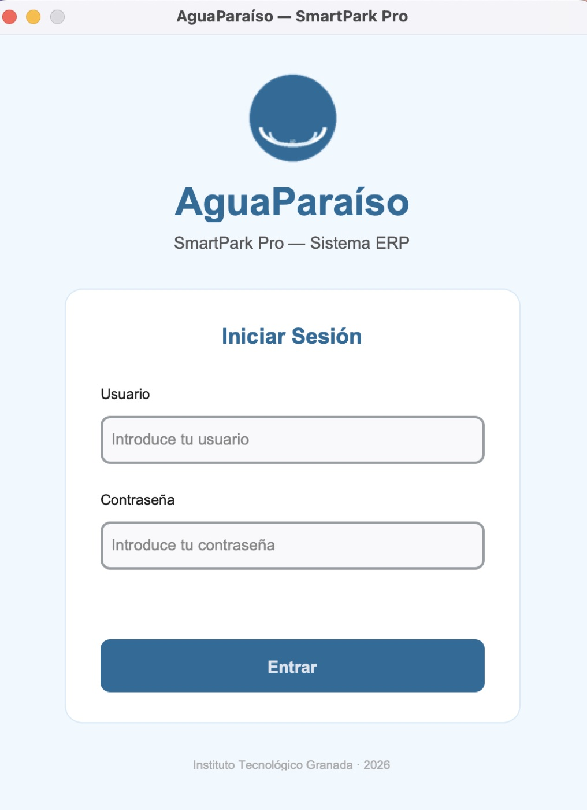
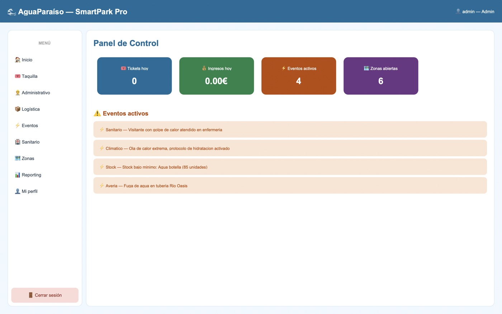
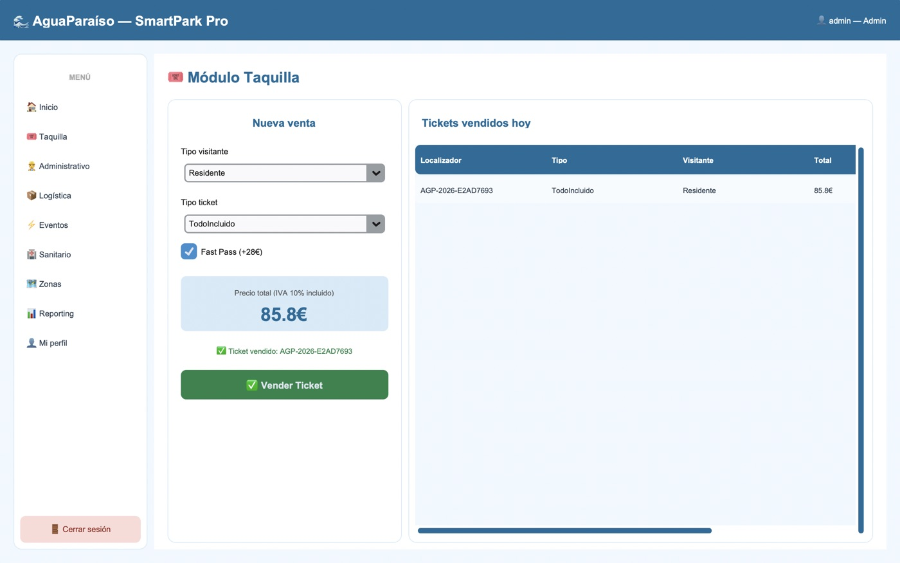
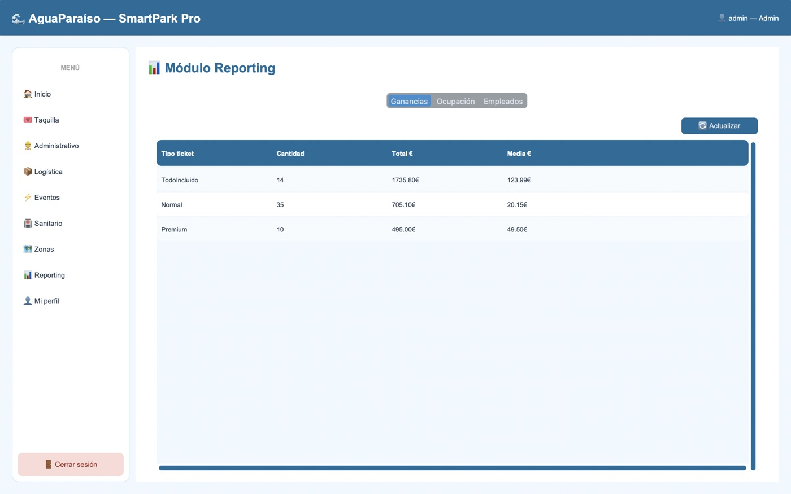

# 🌊 AguaParaíso — SmartPark Pro

🌐 **English** · [Español](README.md)

Desktop ERP system for the full management of a themed water park. Final project for the Programming module at Instituto Tecnológico de Granada (2026).

## Screenshots

| Login | Control panel |
|:-:|:-:|
|  |  |

| Ticket office module | Reporting module |
|:-:|:-:|
|  |  |

## System modules

- **Login:** bcrypt authentication with lock-out after 3 failed attempts.
- **Dashboard:** control panel with a real-time summary.
- **Ticket office:** ticket sales with 10 % VAT and a UUID locator.
- **Administration:** HR, hiring and dismissals, and payroll with income tax withholding.
- **Logistics:** inventory control with low-stock alerts.
- **Events:** random event engine that runs automatically every 5 minutes.
- **Health:** health incident log.
- **Zones:** status and capacity of the park's 6 zones.
- **Reporting:** statistics using JOIN, GROUP BY, SUM and AVG.

## Tech stack

| Technology | Version | Use |
|---|---|---|
| Python | 3.10 or higher (tested with 3.14) | Main language |
| CustomTkinter | 5.2.2 | Graphical interface |
| SQLite3 | Included with Python | Database |
| bcrypt | 5.0.0 | Password hashing |
| python-dotenv | 1.2.2 | Environment variables |
| pytest, pytest-cov | 9.0.3, 7.1.0 | Unit tests and coverage |

## MVC architecture

- `models/`: Python classes using OOP, inheritance and encapsulation.
- `controllers/`: business logic.
- `views/`: graphical interface with CustomTkinter.
- `database/`: SQLite3 connection using the Singleton pattern, and SQL scripts (`schema.sql`, `triggers.sql`, `seed.sql`).
- `utils/`: logger, security, validators, generators and the event engine.
- `exceptions/`: custom exception hierarchy.
- `scripts/`: `init_db.py` (creates the database with sample data) and `reset_db.py` (resets it).
- `tests/`: model, controller and database tests.

## Database

9 SQLite3 tables: `zonas`, `atracciones`, `empleados`, `usuarios`, `visitantes`, `tickets`, `inventario`, `eventos` and `nominas`, plus 7 automatic triggers that keep the data consistent.

## Getting started

### Requirements
- Python 3.10 or higher
- Git

### 1. Clone the repository
```bash
git clone https://github.com/ZakariaeBouhaba/AguaParaiso.git
cd AguaParaiso
```

### 2. Create and activate the virtual environment
```bash
# macOS / Linux
python3 -m venv .venv
source .venv/bin/activate

# Windows (PowerShell)
python -m venv .venv
.venv\Scripts\activate
```
On Windows, if PowerShell blocks scripts: `Set-ExecutionPolicy -ExecutionPolicy RemoteSigned -Scope CurrentUser`.

### 3. Install dependencies
```bash
pip install -r requirements.txt
```

### 4. Create the configuration file
```bash
cp .env.example .env        # On Windows: copy .env.example .env
```
Open `.env` and replace `SECRET_KEY` with your own value.

### 5. Initialise the database (first time only)
```bash
python scripts/init_db.py
```

### 6. Run the system
```bash
python main.py
```

## Demo credentials

> ⚠️ These accounts exist only to try out the application. Do not reuse these passwords anywhere real.

| User | Password | Role |
|---|---|---|
| admin | admin123 | Admin |
| maria.taquilla | admin123 | Ticket seller |
| juan.taquilla | admin123 | Ticket seller |
| antonio.tecnico | admin123 | Technician |
| roberto.camarero | admin123 | Waiter |
| alejandro.enfermero | admin123 | Nurse |

## Tests

```bash
pytest
pytest --cov        # with coverage report
```

## Documentation

- 📄 [Technical report (PDF, in Spanish)](docs/memoria_tecnica_Zakariae_Bouhaba.pdf)
- 🗄️ [Database diagram](docs/diagrama_bd.png)
- 🧩 [Class diagram](docs/diagrama_clases.png)
- 🔁 [MVC flow diagram](docs/diagrama_flujo_mvc.png)
- 🔁 [AguaParaíso flow diagram (PDF)](docs/diagrama_flujo_aguaparaiso.drawio.pdf)

## Author

**Zakariae Bouhaba** — Web Application Development student (Granada, Spain)

[Portfolio](https://zakariaebouhaba.github.io) · [LinkedIn](https://www.linkedin.com/in/zakariae-bouhaba-02472b3ba/) · [GitHub](https://github.com/ZakariaeBouhaba)
